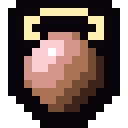

# POErim

Path of Exile style item crafting for Skyrim SE/AE, on top of Diablo-style randomized loot. An SKSE plugin with a small ESL plugin for the orbs, and its own build of Grid Inventory in `grid/`.

POErim is a fork of **Diablo In Skyrim (DiabloRim)** by tangwesley. The loot system comes from that mod: the roller, the affix tables, and how affixes are attached to items and kept in the save. This fork adds Path of Exile's rarity and mod rules, implicits, nine crafting orbs that drop and are used in the inventory, a currency pouch, richer tooltips and a debug menu. It is designed to be played with [ARPG POV](https://www.nexusmods.com/skyrimspecialedition/mods/198647).

> **Do not install POErim alongside the original Diablo In Skyrim.** They are the same plugin (`DiabloInSkyrim.dll`) and share one co-save. POErim replaces it, and reads its saves.

## The orbs

Nine crafting orbs, each with its own face and its own mood. They are hand-built 128x128 pixel art with a thick black outline, drawn for this mod. They sit in your inventory at 1x1, and right-clicking one lets you use it on an item.

<p align="center">
<table>
<tr>
<td align="center"></td>
<td align="center"></td>
<td align="center"></td>
<td align="center"></td>
<td align="center"></td>
<td align="center"></td>
<td align="center"></td>
<td align="center"></td>
<td align="center"></td>
</tr>
<tr>
<td align="center"><sub><b>Transmutation</b></sub></td>
<td align="center"><sub><b>Augmentation</b></sub></td>
<td align="center"><sub><b>Alchemy</b></sub></td>
<td align="center"><sub><b>Exalted</b></sub></td>
<td align="center"><sub><b>Chaos</b></sub></td>
<td align="center"><sub><b>Scouring</b></sub></td>
<td align="center"><sub><b>Divine</b></sub></td>
<td align="center"><sub><b>Vaal</b></sub></td>
<td align="center"><sub><b>Regal</b></sub></td>
</tr>
</table>
</p>

<sub>Left to right: Transmutation (serene), Augmentation (furious, with spikes and loose shards), Alchemy (startled, with four bubbles popping off it), Exalted (stern, under a crown), Chaos (unhinged, mismatched eyes), Scouring (drowsy, slashed), Divine (gold with sapphire, a halo round its head, face tipped up), Vaal (a menacing red rock), Regal (half cobalt, half gold, crowned).</sub>

## Status (2.1.1)

| | |
|---|---|
| Currency pouch filter: orbs from corpses, shops, chests and splits go to the pouch; quest items never hidden | **Fixed in 2.1.1** |
| Orbs drop into the corpse by default (`EnemyGearMode=ALL_INVENTORY`) | **Changed in 2.1.1** |
| Nothing touches references or inventories during loads and load doors | **Fixed in 2.1.1** |
| Affix loot on NPC gear, containers, vendors, quest rewards | Working |
| Rarity by mod count: normal / magic / rare, corrupted red | **New in 2.1.0** |
| Every item has a base implicit; implicits replace vanilla enchantments | **New in 2.1.0** |
| Nine orbs with Path of Exile 1 rules, Regal Orb added | **New in 2.1.0** |
| Orb drops scale with difficulty | **New in 2.1.0** |
| Currency pouch window in Grid Inventory | **New in 2.1.0** |
| Orbs always 1x1 with their own icon | **Fixed in 2.1.0** |
| Orbs as items, orb drops, using orbs in Grid Inventory | Working (1.3.0) |
| Per-item affix records in the co-save, old items rebuilt | Working (1.1.0) |

See [CHANGELOG.md](CHANGELOG.md).

## Rarity and mods

An item's **rarity is its number of mods** (prefixes and suffixes), as in Path of Exile:

| Rarity | Mods | Caps | Colour |
|---|---|---|---|
| Normal | 0 | | white |
| Magic | 1-2 | 1 prefix + 1 suffix | blue |
| Rare | 3-6 | 3 prefixes + 3 suffixes; the 5th and 6th mod need item level 35 and 40 | yellow |
| Corrupted | any | locked | red (overrides the rarity colour) |

Uniques and quest items are not rolled and keep their own look. Tiers I to III are the quality of one mod (its roll range) and no longer decide colour. Colours are set in `DiabloLoot.ini [Rarity]`.

**Items from 1.2.0 and earlier** are re-coloured by their mod count, not their old point band. A 2-mod item that was yellow is now blue. A 1.2.0 item may also hold two prefixes while magic, which 2.1.0 wouldn't roll. It keeps them, and a Regal Orb still works on it.

Prefixes are damage, leech, attributes, armour and unarmed damage; everything else is a suffix. NPC gear rolls at the NPC's level; container and quest loot at the dungeon's or yours.

## Implicits

Every weapon, armour piece and piece of jewellery has **exactly one implicit** from the moment it is made, white items included. Implicits come from `DiabloLoot_affixes_implicits.csv` for the item's kind, sit outside the 3 + 3 cap, and are shown only while you hold **Alt**, under an "Implicit" heading.

- **Implicits replace vanilla enchantments.** New loot (chests, shops, corpses) never carries a vanilla enchantment: an "Iron Sword of Frost" becomes an "Iron Sword" with a rolled implicit, and the frost effect is lost. Enchanted gear an enemy is still *wearing* is left on the body, and is replaced the first time you hover it in your own inventory.
- **Your own vanilla-enchanted ordinary items** get their implicit the first time you hover them. Items **you enchanted** are replaced only when you use an orb on them, never by a hover. Turn all of this off with `ReplaceVanillaEnchants=0`.
- **Never replaced:** uniques and artifacts (no leveled list or outfit hands them out, or no plain version exists to go back to), quest items, socketed items, and items whose mods you merged at an enchanting table.
- Outfit gear (guard helmets and the like) counts as ordinary loot, so it stays craftable after Scouring.
- 1.2.0 items with no implicit get one the first time you hover or craft them. It is flagged so it is never rerolled.
- No orb adds or removes an implicit, except that a Vaal Orb may add a **second** one (at most two). Scouring keeps them and Divine rerolls their values.

The debug menu's Integration page can list exactly which vanilla enchantments in your load order would be replaced.

## Crafting orbs

Orbs drop from kills (into the corpse by default; `EnemyGearMode` in `DiabloLoot.ini`). In Grid Inventory, right-click an orb, then click an item. Shift keeps the orb on the cursor; right-click or Esc puts it back. An orb that can't be used does nothing and is **not** spent, and the item is left exactly as it was.

| | Orb | Works on | Does | Default drop share |
|---|---|---|---|---|
|  | **Transmutation** | Normal item | Magic, 1 mod | 39.4% |
|  | **Augmentation** | Magic, exactly 1 mod | Adds the second mod (the other kind); stays magic | 33.1% |
|  | **Alchemy** | Normal item | Rare, 4 mods | 4.3% |
|  | **Exalted** | Rare, 3-5 mods | Adds a mod, up to 6 (5th and 6th gated at item level 35/40) | 3.4% |
|  | **Chaos** | Rare, 3-6 mods | Rerolls every mod, keeping the count | 6.7% |
|  | **Scouring** | Any item with mods | Removes every mod: normal again; implicits stay | 7.7% |
|  | **Divine** | Anything with a range | Rerolls every value, implicits included, inside its tier | 0.6% |
|  | **Vaal** | Anything not corrupted | Corrupts it (see Vaal Orb below) | 1.0% |
|  | **Regal (new)** | Magic, exactly 2 mods | Adds a third mod, keeps the others; now rare. On 1 mod: "Needs 2 mods; use Augmentation first" | 3.8% |

Drop share is each orb's weight out of the total at the default `OrbWeight*` settings, once an orb drops.

**Corrupted** items are locked: no orb works on them, including Divine and Scouring, and no value is rerolled. The refusal says "Corrupted".

**Vaal Orb.** First, 25% of the time (`VaalAddImplicitChance`), it tries to add a second implicit. That only works on an item that has exactly one, with no duplicate and nothing sharing a magic effect. If nothing fits, the item is just corrupted. Otherwise it's destroy / values up or down / reroll the mods, by weight. With the defaults the split is 25% each, the same as 1.2.0.

New mods follow the same rules as a drop: the item's slots, its stored item level, the caps, the level gates, no mod twice and no two mods from one mod group.

## Orb drops

Orbs go into the corpse by default (`EnemyGearMode=ALL_INVENTORY`, 2.1.1); `ORBS_GROUND` puts them on the ground beside it as before 2.1.1. The drop happens when the game reports the enemy dead, which is after the death animation, so a corpse can take a moment to show its orbs.

`OrbDropChance` that a kill drops orbs, then `OrbBaseCount + OrbCountPerLevel x level` of them (at most `OrbMaxCount`), times `OrbDropMultiplier`. Which orb is drawn by weight; Regal sits between Alchemy and Exalted.

**Difficulty:** the count is multiplied by `1.0 + 0.15 x difficulty` (Novice x1.00 to Legendary x1.75). `DropQuantityMultiplier=Auto` follows the game's difficulty live, or set a number of 1.0 or more. The whole part always drops and the remainder is the chance of one more. Gold and gear are unchanged.

## Currency pouch (Grid Inventory)

A separate window beside the inventory, opened by the **Orbs** button on the inventory's right edge (or a hotkey). It has one slot per orb in a fixed order, always shown, dimmed at 0, with your total under them ("Orbs you pick up appear here" while empty). Hover a slot for the name, what it does and how many you have. Right-click a slot to put one orb on the cursor and click an item to use it. Drag a slot out of every window to drop the whole stack on the ground. **Deposit all** takes every orb off the inventory board and keeps it in the pouch.

- Only the nine orbs (`DiabloInSkyrim.esp` 0x801-0x809) are currency. Quest items, keys, gems, soul gems and every other misc item stay on the board and are never hidden, changed or armed by a right-click.
- The board applies the pouch every time it is built, whatever caused it: a corpse *Take* or *Take all*, a purchase, a chest transfer, a stack split or moving gold all end the same way. While a container or shop is open, orbs are tiles (so you can store and sell them); back in the plain inventory they go to the pouch.

- The pouch is a **view** of your own inventory, with no storage of its own. Weight, vendors and other mods see the orbs as ordinary items, and nothing can be duplicated or lost through it.
- With the pouch on, orbs don't take cells on your inventory board. In shops and containers they're ordinary 1x1 tiles, so you can sell and store them. Orbs in other containers and vendors always show as tiles there, and the pouch never opens on those screens.
- With the pouch off, orbs are ordinary 1x1 items, 20 to a cell. 45 orbs show as 20 / 20 / 5, but that split is display only.
- Settings go in `GridInventory_ui.ini`:

| Setting | Default | |
|---|---|---|
| `CurrencyPouch` | 1 | The pouch on or off |
| `CurrencyPouchHotkey` | (none) | A letter that opens and closes the pouch |
| `CurrencyPouchX` / `CurrencyPouchY` | -1 / -1 | First-open position; -1 = beside the inventory |
| `CurrencyPouchDebugLog` | 0 | **New in 2.1.1.** A line per board refresh in `GridInventory.log`: what asked for it, tiles shown, orbs hidden for the pouch, other forms hidden, and where every quest item went |
| `UiStateDebugLog` | 0 | **New in 2.1.1.** A line per menu open/close and per reset at save loads, load screens and menu closes: text-input capture, the active ImGui widget, the quick wheel, the armed orb, the pouch's drag and queued drops |

POErim's Grid build defaults to the **Fable Crimson** skin from 2.1.1. A `!skin3 = <name>` line in `GridInventory_ui.ini` still wins (ARPG POV's shipped `GridInventory_ui.ini` sets `Parchment Crimson`).

## Known issues

- **Orbs on the ground use a vanilla cut-gem mesh**, so the orb's own texture does not show in the world (only in the inventory and pouch, which use the PNG icons). No orb mesh ships yet.
- **Orbs inside a corpse get no name tag.** ARPG POV labels things lying on the ground; a corpse gets its outline, and its orbs show when you loot it.
- **Menu keys dead after a load door, and a crash on a cell change** (one report, after Bleak Falls Sanctum). 2.1.1 clears every piece of UI state at every load screen and keeps POErim's tasks away from references while the world loads; the cause is not confirmed. If it happens again: set `DebugLoadLog=1` in `DiabloLoot.ini`, `UiStateDebugLog=1` in `GridInventory_ui.ini` and `[Debug] LoadState = 1` in `ARPGPOV.ini`, reproduce, and send `DiabloInSkyrim.log`, `GridInventory.log`, `ARPGPOV.log` and the Crash Logger log.

## Requirements

| | |
|---|---|
| Game | Skyrim SE / AE, 1.5.97 through 1.7.x |
| Required | [SKSE64](https://skse.silverlock.org/), [Address Library for SKSE Plugins](https://www.nexusmods.com/skyrimspecialedition/mods/32444) |
| Required | [ARPG POV](https://www.nexusmods.com/skyrimspecialedition/mods/198647). Without it POErim logs an error and shows a message on load, and keeps running so saves aren't broken. |
| Required | `DiabloInSkyrim.esp` (ESL-flagged, in the mod) for the orbs |
| Included + required | POErim's Grid Inventory build (`GridInventory.dll`), for colours, tooltips, prices, using orbs and the pouch. It overwrites the DLL of the Nexus Grid Inventory but does not include that mod's icon pack, item and category tables, slot art or languages, so keep the original installed and let POErim win the file conflict. |
| Optional | SKSE Menu Framework, for the debug menu |
| Optional | Socketing, Summermyst (affix add-on table included) |

## Install

1. Remove the original Diablo In Skyrim if you have it. Your saves carry over.
2. Download the `POErim` artifact from the latest [Actions build](../../actions) (or a release, once there is one).
3. In Vortex: *Install From File*, pick the zip, enable it, and enable `DiabloInSkyrim.esp`.
4. Optional: install `POErim-Summermyst-Affixes` the same way if you use Summermyst.

Updating overwrites `DiabloLoot.ini`. Keep a copy if you've edited it.

## Configuration

Player settings are in `Data/SKSE/Plugins/DiabloLoot.ini`. Every setting is optional and documented in the file. New in 2.1.0:

| Setting | Default | |
|---|---|---|
| `[Rarity] RarityColorNormal/Magic/Rare/Currency/Corrupted` | C8C8C8 / 8888FF / FFFF77 / D7B45F / D22828 | Colours (RRGGBB) for the tint, the tooltips and ARPG POV |
| `[Rarity] RarityWeightsLevel1/12/25/40` | 55,42,3 / 30,57,13 / 15,57,28 / 6,44,50 | Normal, magic, rare weights for drops. The defaults keep 1.2.0's average mod count |
| `ReplaceVanillaEnchants` | 1 | Replace vanilla enchantments with implicits (see Implicits) |
| `VaalAddImplicitChance` | 0.25 | Chance a Vaal Orb tries to add a second implicit |
| `DropQuantityMultiplier` | Auto | Orb count multiplier: Auto (by difficulty) or a number of 1.0 or more |
| `DropQuantityPerDifficulty` | 0.15 | Step per difficulty level |
| `OrbWeightRegal` | 40 | Regal Orb drop weight |

New in 2.1.1:

| Setting | Default | |
|---|---|---|
| `EnemyGearMode` | ALL_INVENTORY | **Default changed** from ORBS_GROUND: orbs go into the corpse with its gear. The debug menu's *Reset from the INI* now also puts this (and `OrbDrops`, `OrbPlacement`, `BundleGold`) back to the default when the INI has no line for it |
| `DebugLoadLog` | 0 | Diagnostic: every load screen and save load, and every death, first-sight implicit or loot roll that waited for the world to load or was skipped because its cell was unloading |

`VaalWeightImplicit` is gone (every item has an implicit now); `VaalAddImplicitChance` replaces it. `PriceMult*` and `WeaponCharge*` keep their Blue..Red names but now follow an item's point total (1-3, 4-6, 7-9, 10-12, 13+), not its colour.

Earlier settings: `MaxPrefixes`/`MaxSuffixes` (rare caps, 3/3), `TooltipItemLevel`, `TooltipAffixLines`, and `TooltipDetailKey` (18 = Alt: shows the implicits, the Prefix/Suffix headings, tiers and ranges).

## Debug menu

With SKSE Menu Framework installed, press **F1** and open **Diablo In Skyrim Debug Menu**:

| Page | What it does |
|---|---|
| Integration | Version and runtime. ARPG POV: loaded, whether it is using DiabloLootAPI v2, and the last colour handed over. Grid Inventory, the currency pouch, and per orb its mesh, grid size and icon source (red if not a vanilla gem mesh, not 1x1 or not its own PNG). Reload the CSVs without a restart. List the vanilla enchantments that will be replaced |
| Inspect | The item last hovered in Grid Inventory, and every rolled item you carry: rarity, mods, implicits, item level, each mod's tier, value and range, and what the co-save holds |
| Craft simulator | Uses one orb on a copy of an item N times and shows the rarity split. Changes nothing |
| Craft on items | **Changes your save.** Apply any orb for free. Remove a mod. Reroll any mod's or implicit's value. "Vaal-add implicit" (same rules as the Vaal outcome). Toggle the corrupted lock. Spawn a base item at a chosen rarity and item level |
| Orbs & drops | Spawn orbs (Regal included), live drop tuning, and the difficulty multiplier (active value, source, Auto checkbox, 1.0-3.0 slider), with save to INI and reset |
| Co-save | Counts, an orphan check, clear rolled marks for this cell |
| Log | Log level and log file |

## Tuning offline: the roll harness

`RollHarness.exe` (in the `POErim-Tools` artifact) runs the roller, the orbs and the drops without the game.

```
RollHarness DiabloLoot_affixes.csv --merge DiabloLoot_affixes_implicits.csv --levels 1,12,25,35,40
RollHarness DiabloLoot_affixes.csv --merge DiabloLoot_affixes_implicits.csv --craft "transmute,augment,regal,exalt*3,chaos*50,divine,vaal"
RollHarness DiabloLoot_affixes.csv --merge DiabloLoot_affixes_implicits.csv --craft "transmute,augment,regal,exalt*3,vaal,vaal,divine,scour,chaos" --chains 20000 --vaal-keep
RollHarness DiabloLoot_affixes.csv --merge DiabloLoot_affixes_implicits.csv --selftest
RollHarness --drops --levels 1,20,50 --drop-mult 1.45
```

Every crafting step checks the rules and prints `<-- BUG` on any break: rarity caps, level gates, mod groups, implicits, Regal results, Chaos counts, refusals that changed an item, and changes to a corrupted item. `--selftest` covers Regal refusals on 0/1/3/6 mods, bit-identical refusals, Chaos keeping 3-6, the co-save round trip for 0 (legacy), 1 and 2 implicits and the corrupted flag, and the difficulty multiplier. At `--drop-mult 1.0` the drop output is byte-identical to a run without it.

## Building

GitHub Actions builds every push (`.github/workflows/main.yml`) and fails on a stale `DiabloInSkyrim.esp` (`python tools/esp/build_esp.py`) or a harness `<-- BUG`. Locally: Visual Studio 2022, CMake, vcpkg with the `x64-windows-static` triplet; CommonLibSSE-NG is fetched at a pinned commit. The orb sprites come from `python tools/orbs/make_orbs.py` (needs Pillow).

## Replacing the orb icons

Each orb's inventory icon is one PNG: `SKSE/Plugins/GridInventory_fallback/item/DiabloInSkyrim.esp_0x000801.png` (Transmutation) through `0x000809` (Regal), in the order of the table above. Drop your own 128x128 PNGs over them, then run **Icon cache reset** in Grid Inventory's Settings → Icons. To regenerate the shipped art, edit and run `python tools/orbs/make_orbs.py`.

## Credits

- **tangwesley**: Diablo In Skyrim (DiabloRim), which this is a fork of
- **skypia0147-dev**: Grid Inventory and its extension API (`src/api/GridInventoryAPI.h`, vendored; POErim's build is in `grid/`)
- **Socketing**: its published API header (`src/api/SocketingAPI.h`, vendored)
- **SKSE Menu Framework**: its public header (`include/SKSEMenuFramework.h`, vendored)
- **alandtse and the CommonLibSSE-NG contributors**
- Path of Exile is Grinding Gear Games'. POErim is a fan project and uses none of its assets: the orb sprites are original pixel art.

## Licence

GPL-3.0. See [LICENSE](LICENSE).
